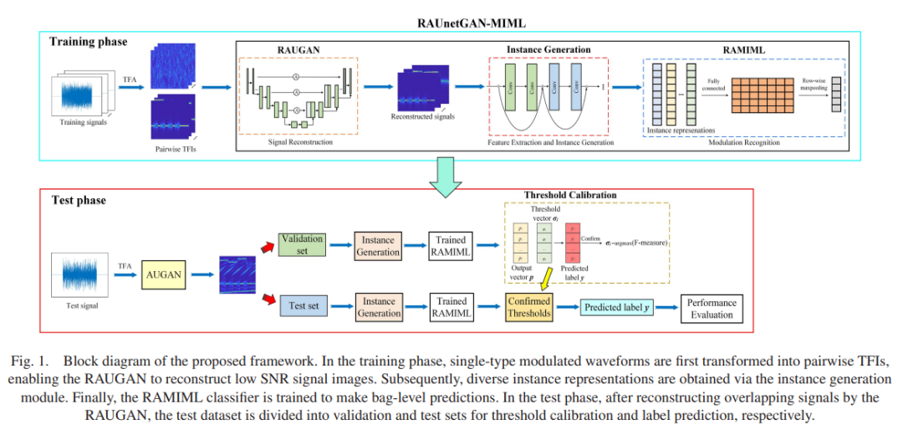
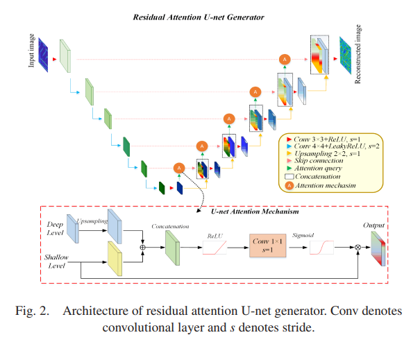
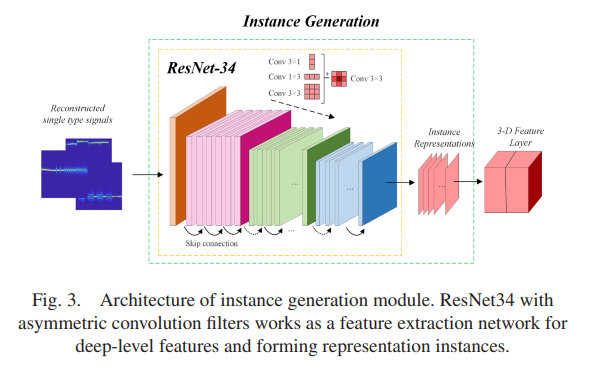
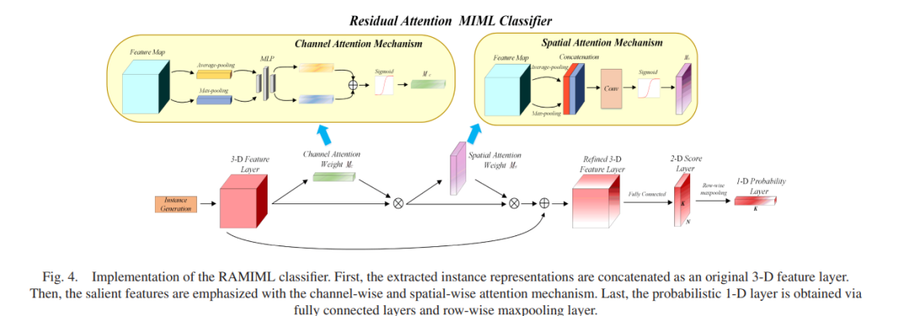
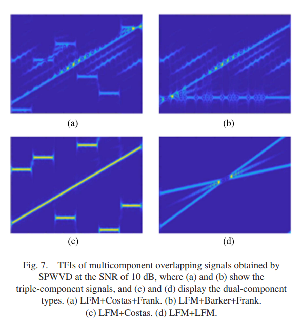
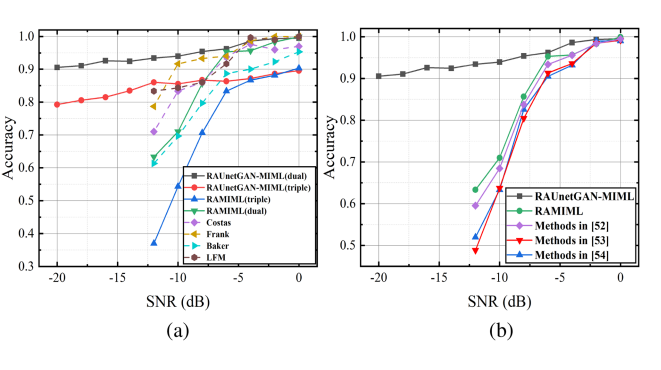
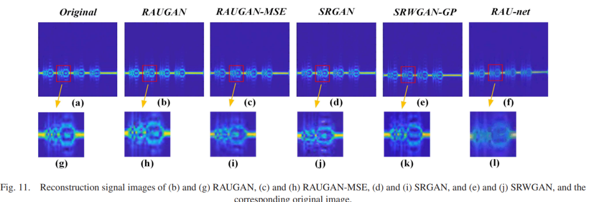
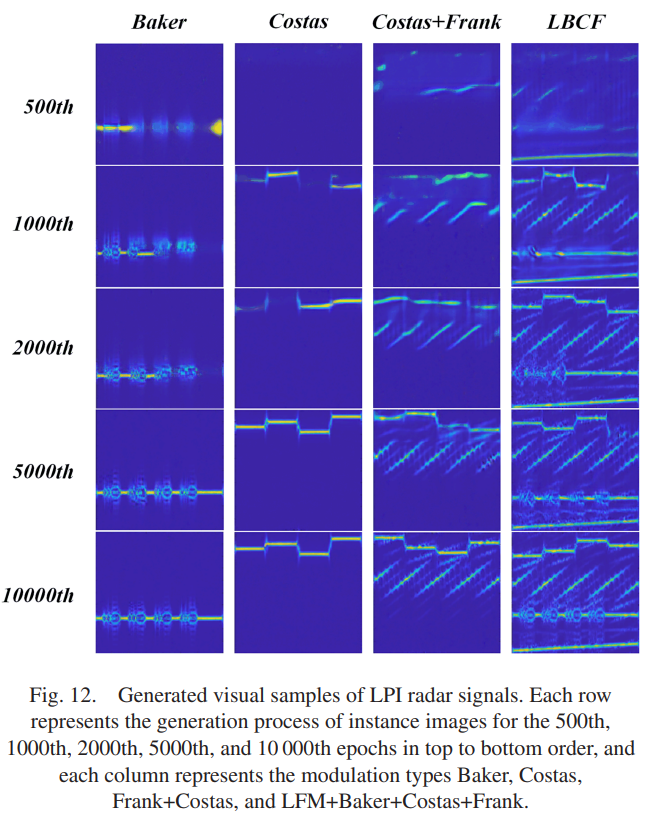

# Application of Residual Attention-Assisted U-Net Generative Adversarial Networks and Multi-Instance Multi-Label Classifier in the Automated Waveform Identification of Overlapping Low Miss Rate Radar Signals[with Python]

This article does not provide a public code dataset, but it can serve as a reference for learning network models. 
In the increasingly complex spectrum environment, the automatic waveform recognition of overlapping LPI (Low Probability of Interference) radar signals is an important and challenging task in electronic reconnaissance. This paper proposes a framework for overlapping LPI waveform recognition that integrates a residual attention-assisted U-Net GAN (Generative Adversarial Network) with a Multi-Instance Multi-Label (MIML) classifier. The framework consists of five cascading modules, achieving satisfactory recognition performance solely through training on a single type of signal. Firstly, the training signals are converted into time-frequency images; then, a Residual Attention U-Net GAN (RAUGAN) with residual learning is used to reconstruct signal images from noisy images under the supervision of high-quality images; next, an instance generation module with asymmetric convolution generates instance representations, which are input to the subsequent Residual Attention MIML classifier (RAMIML); finally, appropriate thresholds for final decision-making are obtained through an adaptive threshold calibration module. Additionally, two loss functions have been meticulously designed for RAUGAN and RAMIML respectively. Extensive experimental results validate the recognition performance of the proposed framework, achieving an accuracy of 80% at a signal-to-noise ratio greater than -18 dB, and demonstrating higher robustness in terms of power ratio and generation performance compared to other state-of-the-art methods.
Introduction: Low Probability of Interference (LPI) radar is widely used in multiple fields, including LPI radar [1] and embedded radar communication [2][3], aiming to prevent enemy receivers from intercepting and perceiving the transmitted signals. In real electromagnetic environments, the number of coexisting LPI radiation sources continues to increase, posing a specific automatic modulation recognition (AMR) task called overlapping LPI waveform recognition (OLWR).
In most studies related to AMR, feature extraction and classifiers are two indispensable parts [4]. The essence of feature extraction is to perform dimensionality reduction and explore effective feature representations with discriminative characteristics. The principle of a powerful classifier is to construct hyperplanes through appropriate algorithms to distinguish candidate categories. Therefore, it is essential to improve the above two modules to build a superior OLWR processing framework.
Signal quality is a key factor in the feature extraction part because low signal-to-noise ratio (SNR) environments blur the foreground signal and are covered by noise. There has been extensive research on this issue, with denoising and signal reconstruction being two common methods to mitigate noise effects while retaining the features of the foreground targets [6]. Methods developed in these studies, including singular value decomposition [7]-[12], empirical mode decomposition [13]-[15], and wavelet transform [16]-[20], typically use subspace algorithms and prior information in different domains to iteratively separate deterministic signals from noise. These methods can significantly improve signal quality, but they may also lose details of perceptual quality and produce artifacts. Moreover, there is a potential risk of poor generalization in practical applications.
In recent years, the development of deep learning (DL) technology has introduced new methods to the field of signal reconstruction. Generative Adversarial Networks (GANs) have been extensively studied, with their basic principle being a competition between two coexisting networks: the generator outputs synthetic samples under the supervision of a discriminator. Goodfellow et al. [25] were the first to introduce GANs, which generate new real data samples that are difficult to distinguish from the input dataset by learning the latent distribution of training data. In fact, GANs are the most advanced model for image reconstruction, achieving unprecedented levels of realism in images [26]. In the field of super-resolution, Ledig et al. [27] proposed an approach called Super-Resolution GAN (SRGAN), which combines adversarial loss with content loss. Although residual learning was used to alleviate gradient issues, the generation capability of this method remained unstable. To improve representation capabilities, [28] introduced a U-net-based method for the first time and has been widely applied in semantic segmentation [29]-[31] and object detection [32]. Additionally, U-net has also been introduced into the field of image transformation [33]-[35]. The pix2pix framework [33] provides a universal solution for supervised image-to-image translation problems by replacing the generator with a U-net structure, and Armanious et al. [35] applied U-net blocks to convert low-dose CT images into high-dose CT images. However, as far as we know, few works have utilized GAN-based methods for radar signal reconstruction.
The classification of OLWR tasks often involves the use of various algorithms, including multi-class learning (MCL) [36][37], multi-label learning (MLL) [38]-[40], multi-instance learning (MIL) [41][42] and multi-instance multi-label (MIML) learning [43]-[46]. MCL methods are considered to be degenerate versions of MLL and MIL, aiming to classify signals limited to having a single label [39]. As a result, the generalization of OLWR is inevitably challenging due to the MCL methods treating overlapping signals as a new type, and the number of labels increases exponentially with the increase in candidate classes. The MLL method can label each component signal and assign corresponding labels to the output vectors, but it treats overlapping signals as individual instances, ignoring the semantic information of different contents. The MIL method first introduces the concept of bagging, focusing on local semantic information, and performs fine-grained predictions from instance-level to bag-level. The main limitation of MIL is its inability to handle overlapping signals, as it only labels individual components. The subsequent MIML principle combines the advantages of these methods [43]. In the MIML theory, images are represented by a set of instances and associated with multiple labels. The goal is to find the relationship between local regions and labels that can be used for unlabeled image classification [44]. Feng et al. established the DeepMIML network by combining convolutional neural networks (CNNs) with the MIML principle [47]. Song et al. [48] proposed a multi-modal CNN (MMCNN-MIML) for MIML image classification, which utilizes the correlation between class labels and combines group textual context with visual instances to assist classification.
Early applications of statistical features to distinguish overlapping signals [49][50] have shown their generalization and interference resistance capabilities to be far from satisfactory. Currently, deep learning-based structures are commonly used for feature extraction. Liu et al. proposed a repetitive selection strategy that segments the time-frequency diagrams and classifies selected areas repeatedly using a CNN [51]. Si et al. and Qu et al. both employ CNNs as the basic structure, respectively, in conjunction with sigmoid functions and deep Q-learning networks to perform multi-label classifiers. Ren et al. utilized an attention-based ResNeXt [55] to combine the multi-domain features of overlapping signals, including time, frequency, autocorrelation, and time-frequency domains, treating each overlapping signal as a new class to execute a multi-class classifier. In [56], the MIML-DCNN framework was the first attempt to adopt a MIML-based approach to study the OLWR task, achieving an overall accuracy of 83% at a signal-to-noise ratio of -6 dB. The framework uses VGG16 [57] as the backbone architecture for feature extraction and employs a deep MIML classifier to predict component types. Table I provides an intuitive comparison of the mainstream methods for constructing the OLWR task from different perspectives. To enhance the performance of the above MIML-based framework, consider the following two aspects: 1) Generative denoising models like GAN can help achieve recognition under lower signal-to-noise ratio conditions; 2) Attention mechanisms and residual structures assist in feature representation and classification modules, focusing on significant regions and capturing important content information, thereby achieving better performance.
In this paper, we propose a waveform recognition framework named RAUnetGAN-MIML for the OLWR task. The framework first converts captured overlapping signals into time-frequency images (TFIs) through the smoothed pseudo-Wigner-Ville distribution (SPWVD) transformation. Subsequently, it utilizes an U-net GAN structure with residual attention (RAUGAN) to reconstruct low-quality TFIs. An instance generation module with asymmetric convolutions then explicitly generates diverse instances. Finally, an adaptive threshold calibration module obtains appropriate thresholds to implement the residual attention MIML (RAMIML) classifier. The main difference between RAUnetGAN-MIML and [56] is the inclusion of a cascading denoising RAUGAN module and RAMIML classifier. Comprehensive simulations demonstrate the effectiveness and robustness of the proposed framework.
The main contributions of this paper are summarized as follows: 1) an improved processing framework for the OLWR task, named Residual Attention-Assisted U-net GAN and MIML (RAUnetGAN-MIML), which incorporates attention mechanisms in both the RAUGAN and RAMIML classifiers. The combined representation capabilities of significant representation and diverse instance representations improve recognition performance. 2) Based on the principles of MIML, the classifier can achieve satisfactory performance even under extremely low signal-to-noise ratio conditions using only a single type of signal for training. 3) New loss functions have been designed for RAUGAN and RAMIML respectively. The former integrates the Mean Absolute Error (MAE) and Mean Square Error (MSE), while the latter combines Cross Entropy and Lasso regularization. The newly designed loss functions can capture high-frequency content and help solve sparse MIML problems.
The rest of this article is organized as follows: Section II defines the signal model and formulas for the OLWR task. Section III provides a detailed description of the proposed RAUnetGAN-MIML framework and its component modules. Section IV introduces the experimental datasets, evaluation metrics, and baseline methods. Section V presents simulation results and performance analysis. Finally, Section VI summarizes the paper.
Article illustrations
Conclusion In this paper, we propose an OLWR framework named RAUnetGAN-MIML that utilizes residual attention-assisted U-net GAN and MIML classifiers. The framework first uses high-SNR time-frequency images as templates to reconstruct low-SNR time-frequency images in RAUGAN. A cascading instance generation module that fully leverages asymmetric convolutions is designed to generate diverse instance representations, which have been proven to be more discriminative in image classification. Subsequently, a RAMIML classifier is proposed that utilizes multi-semantic instance representations from the preceding module to identify each component modulation type within overlapping signals. RAUnetGAN-MIML makes fine-grained classification decisions at the package level through an adaptive thresholding module. Additionally, two redesigned loss functions enhance the training process on sparse time-frequency image datasets. Experimental results demonstrate that the proposed RAUMIML outperforms all baseline models in both OLWR and LWR tasks.
Future work can include the following aspects: 1) As the number of transmitted signals and their types of overlap significantly increase in real-world electromagnetic environments, it is necessary to study recognition performance under more diverse conditions of overlap; 2) In non-cooperative scenarios, data collected may be inaccurate or inaccurate, thus researching improved OLWR solutions for small sample data is warranted.
End

## Images

<!-- PAYMENT_BLOCK -->

## Get this dataset

- Payment link (Stripe): [Buy now](https://buy.stripe.com/3cs8yP7sY87d0vu9AB)
- Payment QR code: 

<!-- /PAYMENT_BLOCK -->
